# Training Management System

A full-stack web application for running the training side of a data-science bootcamp: weekly agendas, Google-Forms-style student surveys with personal links, a gradebook synced from Google Classroom, and a library of training materials.


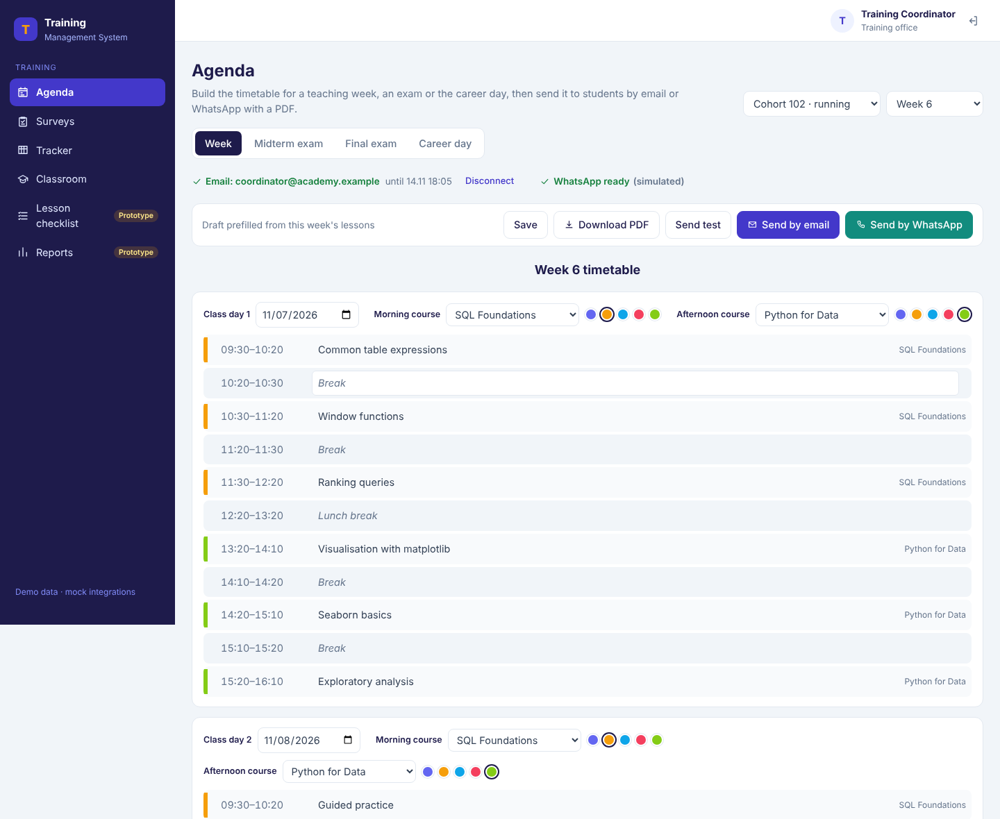

> **Portfolio project.** This is an independent rebuild, with my own code, wording and design, of a training module I led for an academy's internal staff portal. It contains **no original source code, data, branding or confidential material**. Every person, cohort and grade in the demo is fictional, and all external services (Google, Gmail, Classroom, WhatsApp) run as offline mocks. See [Origin and my contribution](#origin-and-my-contribution).

---

## Contents
- [What it does](#what-it-does)
- [Screenshots](#screenshots)
- [Architecture](#architecture)
- [Tech stack](#tech-stack)
- [Quick start](#quick-start)
- [Trying the integrations offline](#trying-the-integrations-offline)
- [Testing and quality](#testing-and-quality)
- [Project structure](#project-structure)
- [Security and privacy](#security-and-privacy)
- [Limitations and next steps](#limitations-and-next-steps)
- [Origin and my contribution](#origin-and-my-contribution)

---

## What it does

A training office runs several cohorts at once. Two courses are taught in parallel every week, and every week someone has to tell students the timetable, ask them how the week went, chase homework and send out materials. This app turns those chores into four connected workflows.

### 📅 Agenda
- **Draft.** A timetable for a teaching week is prefilled from the scheduled lessons and that week's topics. If a cohort has no timetable yet, it comes from its Google Classroom coursework.
- **Other agendas.** Midterm, final and career-day agendas use free-form rows.
- **Editing.** Change the dates, courses, colours and topics, then save. Unsaved changes are guarded.
- **PDF.** Generate an A4 **PDF** with Unicode fonts.
- **Sending.** Send by **email** (PDF attached) or **WhatsApp** (template message with the PDF) to students picked across cohorts, or first to a test address.

### 📝 Weekly survey
- **Editor.** A form editor that mirrors what students see.
  - One block per course taught that week: an understanding scale plus a comment. Day 1 / Day 2 blocks are split automatically from the course catalogue.
  - Rating grids for trainers, mentors (with a "did not work with them" option) and materials. Each grid can ask about its own week.
- **Draft.** Prefilled from the week's lessons, from Classroom, or from last week's survey moved forward a week.
- **Sending.** Every student gets a **personal, unguessable link** by email or WhatsApp. Staff can open a **signed preview link** whose answers are never saved.
- **Student form.** A server-rendered, phone-friendly page that checks required answers and accepts **exactly one answer per link** (row-level lock).
- **Results.** Answer counts and 1–5 averages per course block, trainer, mentor and material, with comments, who answered, and **"remind those who have not answered"**.
- **Course catalogue.** The list of courses that the agenda and survey both use.

### 📊 Tracker (gradebook)
- Every student against every published assignment.
- Each cell shows a grade (coloured by %), "submitted, waiting for a grade", missing, a late flag, and a link to the work.
- Totals of work handed in and average % per student.
- Search, filter by week, and sync from Classroom on demand.

### 🔗 Google Classroom
- **Connect** a teacher account through an OAuth flow, here a local mock consent screen. Expiry warnings and reconnect work the way they do with a Google app in testing mode.
- **Group** the account's classes into cohorts by the number in the class name, and **import** chosen cohorts with all their classes, one class per course.
- **Sync** students (matched by email), coursework, submissions, grades and material posts.
  - Unmatched students are listed and can be added with one click.
  - Work graded on the site is never overwritten.
- **Background worker** syncs running cohorts every 15 minutes and finished ones daily, and can auto-import new cohorts. A **PostgreSQL advisory lock** makes several workers safe.
- **Training materials library**:
  - shows each course's material posts, using the fullest set across cohorts with the chosen cohort's own copies, and flags links that come from another cohort;
  - lets you tick materials and students and send them by email.

### Prototypes (clearly labelled)
- **Lesson checklist** and **Reports** are kept as **UI prototypes with sample data**, as in the original system. They are not connected to the API, and the app says so on the page.

### Back-end-only APIs (no UI on purpose)
These exist in the API, documented in Swagger, but have no screen, just as in the original system:
- **Records:** students, lessons, attendance, assignments and grading, materials and recordings, mentoring sessions, action items, a weekly report and a cohort comparison.
- **Student API:** demo sign-in, a week-by-week course view, handing in work, and rating a lesson.

---

## Screenshots

| | |
|---|---|
| 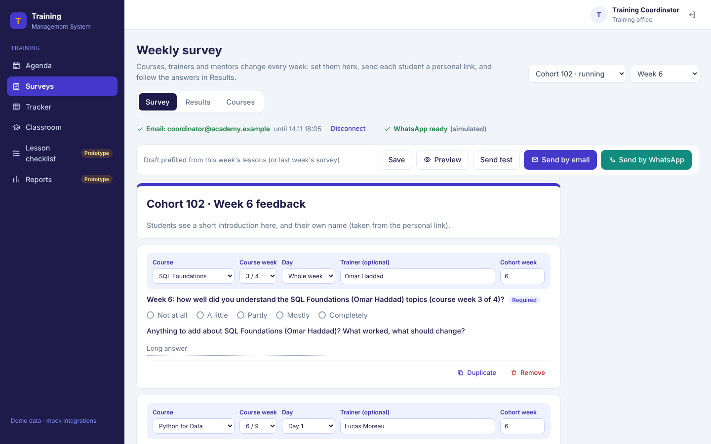 | 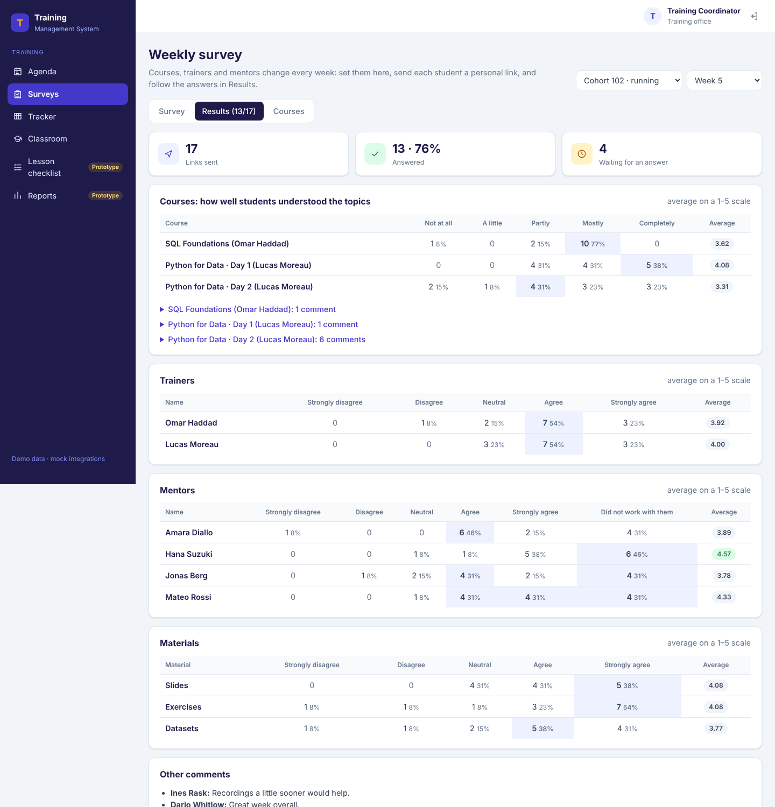 |
| Survey editor: course blocks and rating grids | Results: distributions, averages, comments |
| 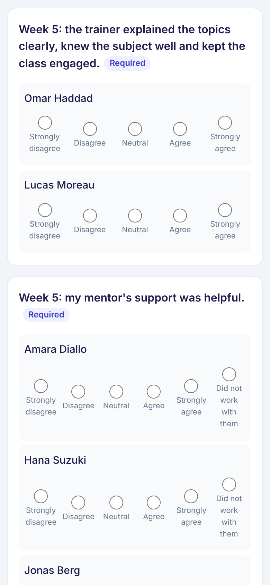 | 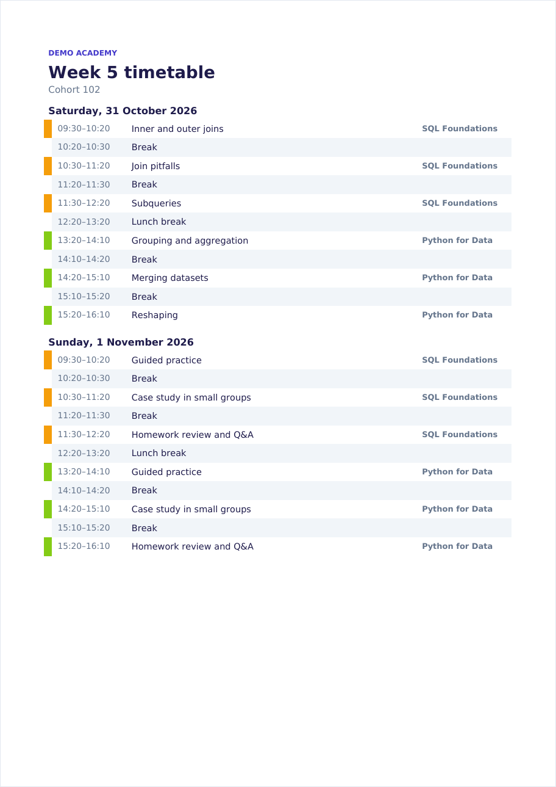 |
| The student's personal survey link on a phone | Generated agenda PDF |
| 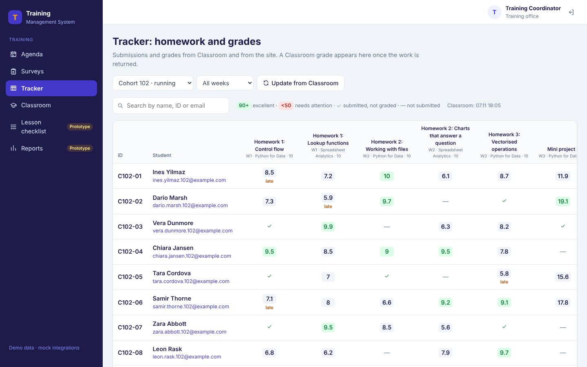 | 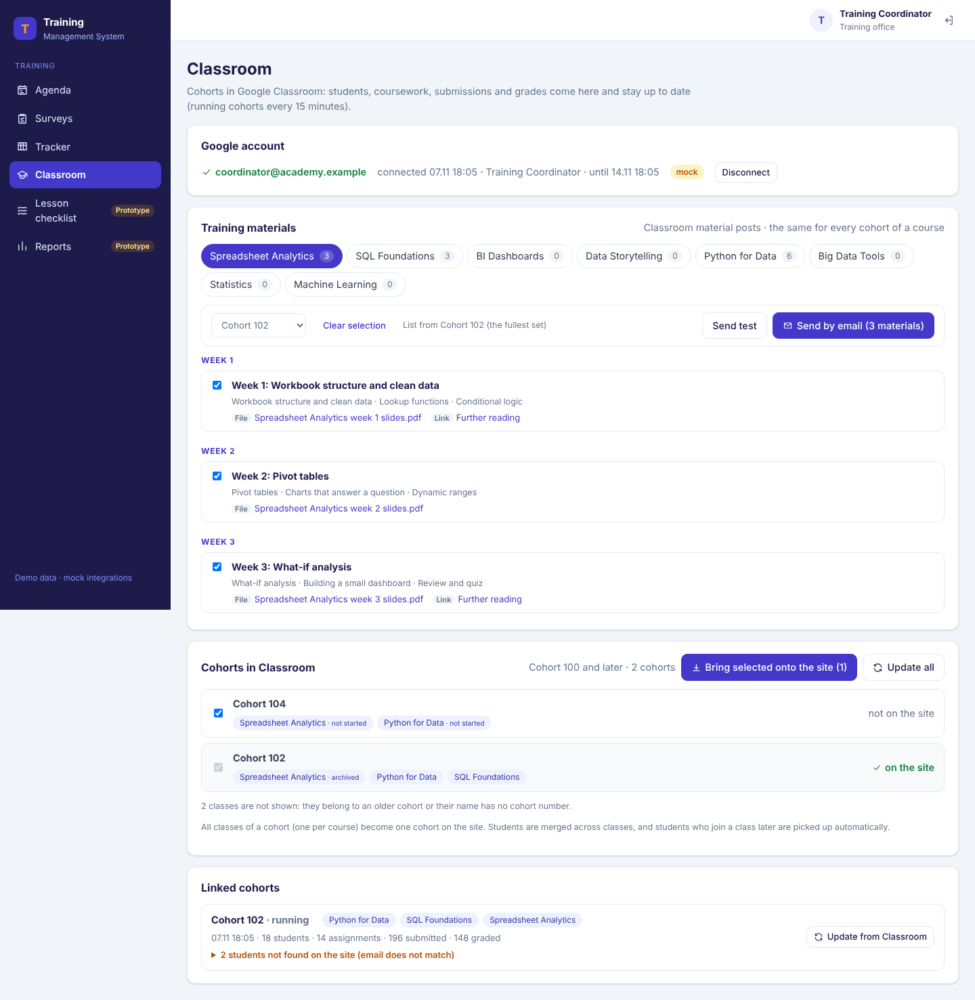 |
| Gradebook synced from Classroom | Classroom connection, materials library, import and sync |
| 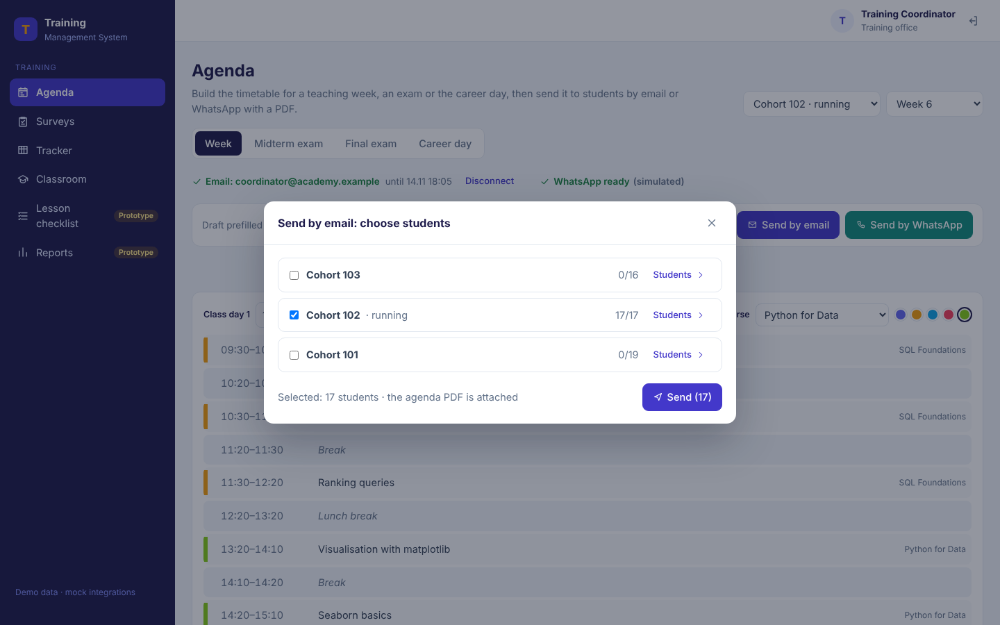 | 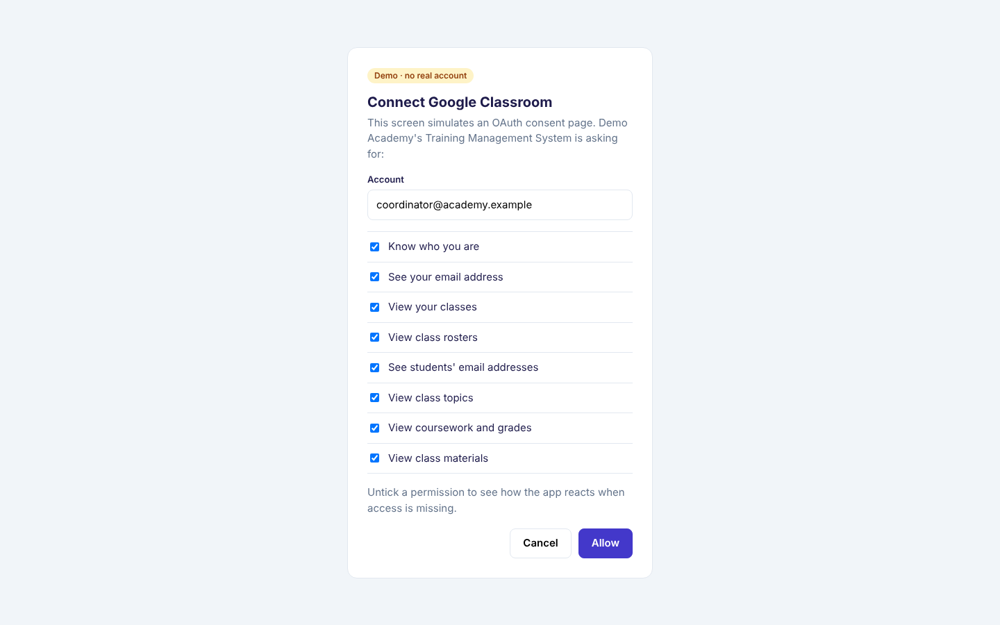 |
| Choosing recipients across cohorts | Offline stand-in for the OAuth consent screen |
| 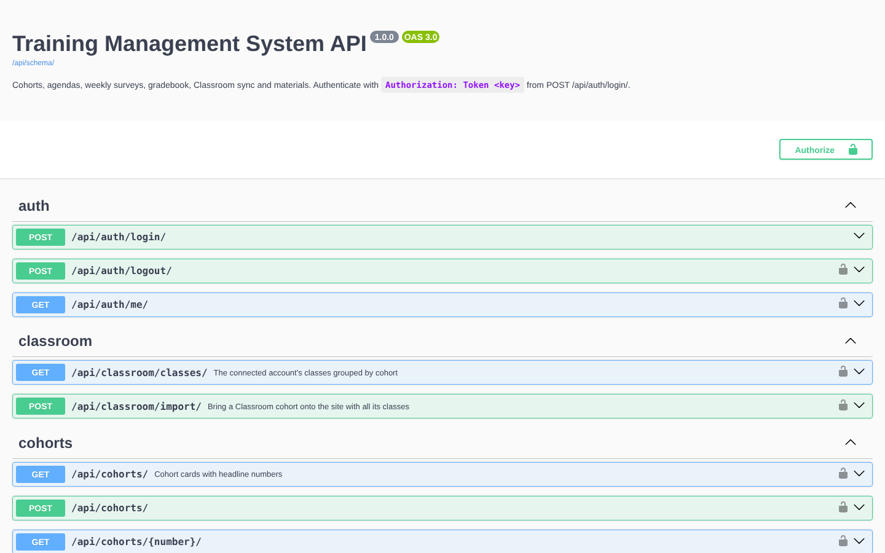 | 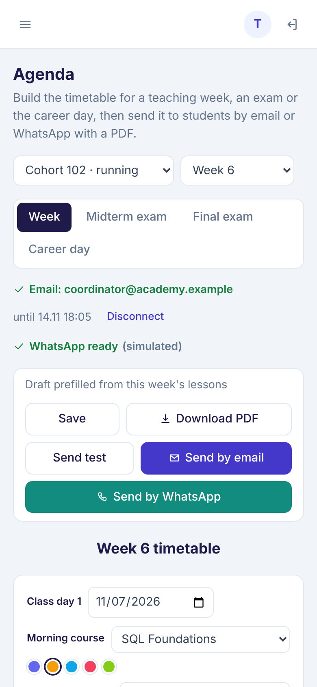 |
| OpenAPI / Swagger documentation | Responsive layout |

---

## Architecture

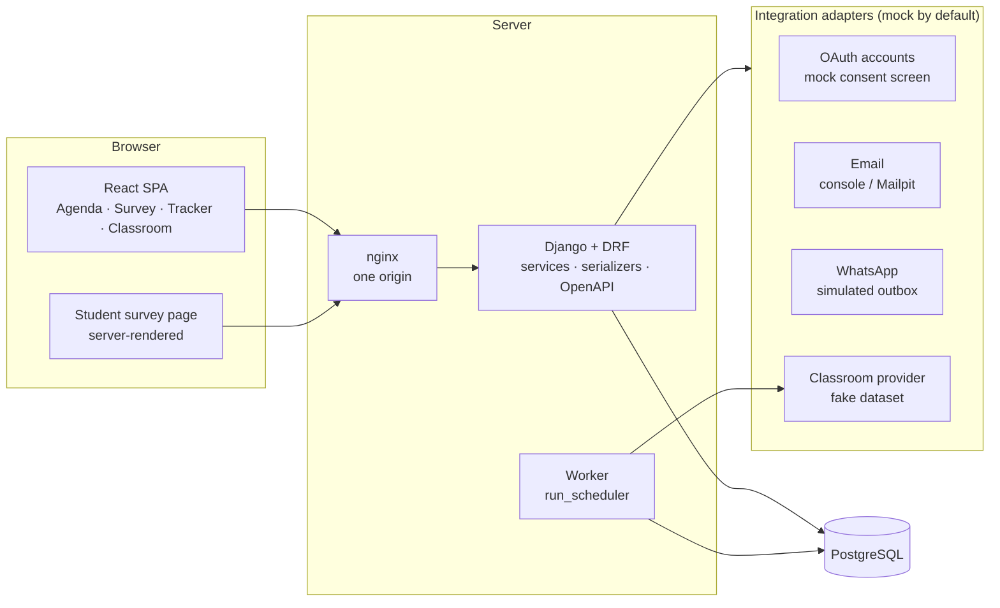

**Key design decisions**
- **Service layer.** Business rules live in `training/services/` (agenda, surveys, gradebook, classroom, library, stats), separate from HTTP. Views stay thin, and the rules are unit-tested directly.
- **Adapters with offline defaults.**
  - **Email** goes through Django's email backend: console locally, Mailpit in Compose.
  - **WhatsApp** messages are recorded as simulated `OutboundMessage` rows.
  - **Classroom** is a provider interface that keeps Google's JSON shapes, backed by a deterministic fake dataset.
  - **OAuth** goes through a local consent page. Tokens are stored encrypted.

  A real implementation can be plugged in behind the same interface.
- **Separate worker process.**
  - `manage.py run_scheduler` handles periodic Classroom sync and auto-import.
  - It is guarded by `pg_try_advisory_lock`, so running two workers is safe.
  - It shuts down cleanly on `SIGTERM`.
- **One origin.** nginx (or the Vite dev proxy) serves the SPA and forwards `/api`, `/s/`, `/oauth`, `/admin` and `/static`, so there is no CORS to configure and the survey links work everywhere.
- **API-first.** There are 81 documented operations, with Swagger at `/api/docs/` and ReDoc at `/api/redoc/`, and one error shape: `{"error": "…"}`.

More detail is in [docs/architecture.md](docs/architecture.md), with the endpoint list in [docs/api.md](docs/api.md).

---

## Tech stack

| Layer | Technology |
|---|---|
| Backend | Python 3.13, Django 5.2 LTS, Django REST Framework, drf-spectacular (OpenAPI), ReportLab (PDF), cryptography (Fernet) |
| Database | PostgreSQL 16 (SQLite for quick local runs) |
| Frontend | React 18, React Router 6, Vite 5, plain CSS with design tokens, no UI framework |
| Background | Django management command worker with a PostgreSQL advisory lock |
| Infrastructure | Docker, Docker Compose (Postgres, API, worker, nginx + SPA, Mailpit), gunicorn, WhiteNoise |
| Quality | pytest + pytest-django (48 tests), ruff, ESLint, GitHub Actions CI |

---

## Quick start

### Option A: Docker Compose (everything)
```bash
cp .env.example .env            # optional; defaults work for a local demo
docker compose up --build
```
- App: http://localhost:8080. Sign in with **coordinator / coordinator-demo**.
- Mail inbox (Mailpit): http://localhost:8025
- API docs: http://localhost:8080/api/docs/

The backend runs migrations and loads the fictional demo data on first start.

### Option B: Local development
Requirements: Python 3.12+ and Node 20+.
```bash
make setup      # virtualenv, npm install, migrate, seed demo data (SQLite)
make backend    # Django on http://127.0.0.1:8000
make frontend   # Vite on http://localhost:5173 (proxies to the backend)
make worker     # optional: the background scheduler
make test       # backend tests
```

---

## Trying the integrations offline

| What | How |
|---|---|
| Connect Google | Classroom → *Disconnect* → *Connect Google account* opens a **mock consent screen**. Untick "View class materials" to see the missing-permission warning |
| Expiry warnings | `python manage.py expire_connection mail` (or `classroom`), or set `MOCK_TOKEN_DAYS=1` |
| Emails | Printed in the backend console, or shown in **Mailpit** with Docker Compose |
| WhatsApp | Recorded as *simulated* messages: Django admin → Integrations → Outbound messages |
| Import a cohort | Cohort **104** exists only in the fake Classroom. Tick it under *Cohorts in Classroom* and bring it onto the site |
| Unmatched students | Cohort 102's Classroom has two late joiners: *Linked cohorts* → *Add these students to the site* |
| Student survey | Survey → *Preview*, or open a personal link from an email |
| Student API | `POST /api/student/auth/mock-sign-in/` with a student's `@example.com` address |

---

## Testing and quality

- **Backend: 48 tests.** Run them with `make test`, or `cd backend && pytest`.
  - **What they cover:** authentication, agenda drafts, saving, PDF and sending; survey drafts, the public form and the one-answer rule; preview links; results; Classroom import and sync, including idempotency, deleted coursework, "site grades win", expiry and the scheduler interval; the library; the gradebook; records; the student API; and the mock OAuth round trip.
  - **Databases:** the suite passes on SQLite and PostgreSQL.
- **Static checks:** `ruff check`, `makemigrations --check`, `eslint`, and a production `vite build`.
- **CI:** [`.github/workflows/ci.yml`](.github/workflows/ci.yml) runs all of the above against PostgreSQL 16.

---

## Project structure

```
training-management-system/
├── backend/
│   ├── config/               settings (environment-driven), urls, test settings
│   ├── accounts/             token login / logout / me, staff permission
│   ├── integrations/         connected accounts (mock OAuth), email, WhatsApp, Classroom provider, PDF fonts
│   ├── training/
│   │   ├── models.py         cohorts, students, lessons, attendance, assignments, submissions,
│   │   │                     agendas, surveys, invites, responses, Classroom classes and materials
│   │   ├── services/         agenda, agenda_pdf, surveys, gradebook, classroom, library, stats, catalogue
│   │   ├── api/              views, serializers, CRUD records, student API, error handler
│   │   ├── public/           the student survey form (server-rendered)
│   │   ├── demo/             fictional demo data, shared by the seed and the fake Classroom
│   │   └── management/       seed_demo, run_scheduler, sync_classroom
│   └── tests/
├── frontend/
│   └── src/
│       ├── pages/            agenda/, survey/, classroom/, TrackerPage, prototypes, login
│       ├── components/       layout, data table, modal, recipient picker, channel status…
│       ├── api/              fetch client and hooks
│       └── i18n/             English by default; Azerbaijani dictionary ready to fill in
├── docs/                     architecture, API reference, screenshots
├── docker-compose.yml
└── .env.example
```

---

## Security and privacy

- **Secrets** come only from environment variables. The app refuses to start without `DJANGO_SECRET_KEY` unless `DJANGO_DEBUG=1`.
- **Access.** A token-authenticated API for training-office staff only. Student tokens are rejected by staff endpoints.
- **Survey links** are random 32-character tokens. Preview links are signed and expire. Every answer is checked against the questions on the server and stored once, under a row lock.
- **Stored OAuth tokens** are encrypted (Fernet).
- **Abuse limits.** Sign-in and the public form are rate-limited.
- **Output escaping.** User text is escaped in emails and PDFs.
- **Demo data** is entirely fictional:
  - emails use the reserved `example.com` / `academy.example` domains;
  - phone numbers come from the `+1 202 555 01xx` fiction range.

---

## Limitations and next steps
- **Integrations.** Only the offline mocks are implemented. Real Google OAuth, Gmail API, Classroom and WhatsApp Cloud API adapters would plug into the existing interfaces.
- **Translation.** The UI is English. The i18n layer is ready for an Azerbaijani dictionary (`frontend/src/i18n/az.js`), and backend texts (emails, survey questions) would need the same treatment.
- **Prototypes.** Lesson checklist and Reports are prototypes, not features.
- **No student UI.** There is no student-facing web UI beyond the survey form; the student API is ready for one.

---

## Origin and my contribution

> **Edit this section in your own words before publishing.**

- **The original module.** I was the product owner and technical lead for the *Training* section of an academy's internal staff portal. I defined the workflows (agendas, weekly surveys, the Classroom gradebook and the materials library), worked with the training team on requirements, configured the Google Cloud and Classroom integration, and ran the rollout.
- **This repository is a clean-room rebuild for my portfolio.** No source code, data, wording, branding or documents from the original system were copied. The features and workflows were reimplemented from a functional description, with new code, a new data model and a new design.
- **AI-assisted development.** The code was written with an AI coding assistant (Claude Code) under my direction. I set the scope and requirements, chose and approved the architecture (service layer, mock adapters, separate worker, OpenAPI, Docker Compose), reviewed the results and tested the workflows. Commits authored by "Claude" reflect this.

## License
Not yet chosen. Until a license is added, all rights are reserved.
