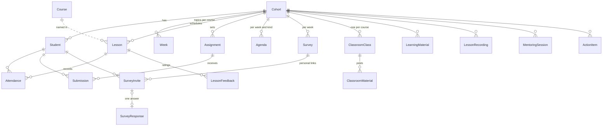

# Architecture

## Components

| Component | Role |
|---|---|
| **React SPA** (`frontend/`) | Staff pages: Agenda, Weekly survey, Tracker, Classroom (+ materials library), two labelled prototypes. Talks to the API with a token. |
| **Django + DRF API** (`backend/`) | REST API, Django admin, the server-rendered student survey form and the mock OAuth consent page. |
| **Worker** (`manage.py run_scheduler`) | Periodic Classroom sync and optional auto-import of new Classroom cohorts. |
| **PostgreSQL** | All data. SQLite works for quick local runs and tests. |
| **nginx** (Compose) | Serves the built SPA and forwards `/api`, `/s/`, `/oauth`, `/admin`, `/static`, `/media` to the API, so the browser sees one origin. In development, Vite's proxy does the same. |
| **Mailpit** (Compose) | Catches all outgoing email in a local web inbox. |

## Backend layout

```
accounts/      token login, staff permission (is_staff or "training-staff" group)
integrations/  ConnectedAccount (OAuth grants, encrypted), OutboundMessage (audit log of every email / WhatsApp)
               accounts.py   mock OAuth: start → consent page → grant with expiry; status, expiry, scopes
               email.py      send through Django's EMAIL_BACKEND, one message per recipient, logged
               whatsapp.py   template messages; MockWhatsApp records them as "simulated"
               classroom/    ClassroomProvider protocol (Google's JSON shapes) + FakeClassroom
               pdf.py        Unicode font registration for ReportLab
training/
  models.py    the domain (below)
  services/    business rules, independent of HTTP
  api/         thin DRF views + serializers; one error handler ({"error": ...})
  public/      student survey form
  demo/        deterministic fictional data shared by seed_demo and FakeClassroom
```

**Rules of thumb used throughout:**
- Views validate input with serializers and delegate to a service. Services raise `ServiceError(message, status)`, which the exception handler turns into `{"error": message}`.
- External services are reached only through `integrations/`.
- Anything sent is logged as an `OutboundMessage`.

## Data model



**JSON fields hold editable documents:**
- `Agenda.days`: days with tracks and rows.
- `Survey.blocks` and the trainer / mentor / material lists.
- `SurveyResponse.answers`, next to denormalised 1–5 scores so reports can aggregate in SQL.

## Key flows

### Sending an agenda
1. `PUT /agenda/`: `agenda.clean()` validates the structure (dates, colours, sizes) and saves it.
2. `POST /agenda/send/`:
   - render the PDF with ReportLab, escaping user text;
   - email each chosen student a personal HTML + text message with the PDF attached, or send WhatsApp `agenda_notice` templates with the PDF;
   - log every message;
   - store when it was sent and to how many students.

### Weekly survey
1. A draft comes from the week's lecture lessons. A course whose catalogue entry splits that week becomes Day 1 and Day 2 blocks. Without lessons, the draft uses Classroom coursework and teachers; without those, last week's survey moved forward a week.
2. `send` creates a `SurveyInvite` (random token) per student and sends `PUBLIC_BASE_URL/s/<token>/`.
3. The student posts the form. `surveys.parse()` checks every answer against the question list, and missing required answers re-render the form with the questions highlighted. Inside a transaction the invite row is locked (`select_for_update`), so a link can be answered only once even with double submits.
4. `results()` aggregates counts and 1–5 averages per block, trainer, mentor and material.

### Classroom sync
```
list_classes()   courses → cohort number from the class name ("Cohort 102 · SQL Foundations")
                 → course from the catalogue name found in the class name
import_cohort(n) create the cohort if missing, link its classes, sync
sync(cohort)     per class: teachers · students (match by email; report or add unmatched)
                 · topics ("Week 3") · coursework → Assignment (external_id = class:work)
                 · submissions → Submission (site-entered grades are never overwritten)
                 · material posts → ClassroomMaterial (needs the materials scope)
                 · deleted coursework / posts are removed; status follows class state + recent activity
```
- **Locking.** The worker calls `sync_due()` (running cohorts every `CLASSROOM_SYNC_MINUTES`, others daily) and, when enabled, `auto_import()` hourly. Both run under `pg_try_advisory_lock`: a second worker skips instead of syncing twice.
- **Errors** are stored on the cohort (`classroom_summary.error`) and shown on the Classroom page.

### Connecting an account (mock OAuth)
`POST /api/integrations/{purpose}/connect/` returns `/oauth/mock/authorize/?state=<signed>`. The consent page lists the scopes, and any of them can be unticked. **Allow** stores an encrypted fake token whose expiry is `MOCK_TOKEN_DAYS`, then redirects to `FRONTEND_URL/<page>?connected=ok`. The frontend shows "expiring soon" 36 hours before expiry, and "expired" after it or after `expire_connection`.

## Configuration

All settings come from environment variables; see `.env.example`.
- **Required in production:** `DJANGO_SECRET_KEY`, `DATABASE_URL`, `DJANGO_ALLOWED_HOSTS` and `DJANGO_CSRF_TRUSTED_ORIGINS`.
- **Integrations:** only the mock modes exist (`GOOGLE_MODE=mock`, `WHATSAPP_MODE=mock`, `CLASSROOM_PROVIDER=fake`).
